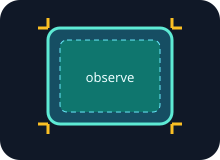

## 🧭 Overview

A local browser playground for observing element size changes with ResizeObserver, comparing content and border boxes, and testing responsive layout changes.

## ✨ Features

- 📐 Observe live content-box and border-box dimensions.
- 🎚️ Resize a target element with width and height controls.
- 🧾 Inspect observer delivery and the latest measurements.
- 🔒 Runs locally and makes no network requests.

## 🎬 Demo

No hosted demo is provided. Start the local server and open the address printed in your terminal. Sharing and clipboard behavior depend on browser support and permissions.

## ⚡ Quick Start

~~~bash
npm start
~~~

## 🧰 Tech Stack

- Node.js 18+ · HTML · CSS · JavaScript
- Node.js built-in HTTP server; no third-party dependencies

## 🗂️ Folder Structure

~~~text
browser-resize-observer-lab/
├── server.js
├── package.json
├── public/index.html
├── public/styles.css
├── public/app.js
├── assets/mark.svg
├── .gitignore
├── LICENSE
└── README.md
~~~

## 🗺️ Roadmap

- [x] Core browser API interactions
- [x] Local server and custom SVG
- [ ] Add browser compatibility notes from community testing

## 🤝 Contributing

Issues and focused pull requests are welcome. Keep the app local-first and explain browser permission requirements clearly.

## 📄 License

MIT License. See [LICENSE](LICENSE).

